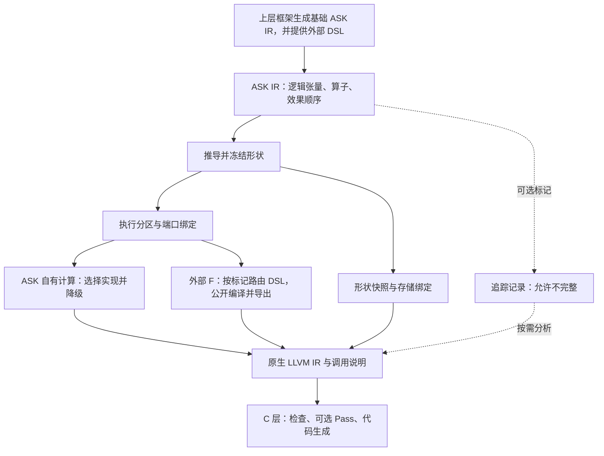

# ASK IR 设计

ASK IR 是 A 层用来表达计算的 IR，采用 MLIR 的 `ask` dialect；它把原来的 `SemanticModule` 具体化。B/C 层的 ASK LLIR 仍然是原生 LLVM IR。两者之间的降级关系见[顶层设计](../核心思想.md#ask-architecture)。这里没有新增架构层。

图编译的输入由上层框架提供：基础 ASK IR，加上图中 `ask.external` 指向的第三方 DSL 和语义/实现记录。ASK 完成检查、形状推导、分区和降级；遇到 external 时，将 DSL 交给指定编译器。框架侧其他 IR 到 ASK IR 的转换在提交之前完成。

这组文档依次回答四个问题：图里存什么；追踪标记怎样插入和消失；形状怎样算出来；张量变成指针之后，后续阶段从哪里读取形状。完整设计仍在逐步落地；当前已实现单基本块 bool / i32 / i64 / f32 / f16 / bf16 子集与显式 cast、外部语义/DSL 声明、形状准备与标记提取。可运行接口和限制见[上层框架接入](../10-上层框架接入.md)，类型转换的固定规则见[类型转换与混合精度](../15-类型转换与混合精度.md)，不能把本文中的完整类型、效果系统与运行时规划视为已支持。

| 文档 | 解决的问题 |
|---|---|
| [00：结构、类型与操作](00-结构类型与操作.md) | 定义模块、SSA、张量、外部算子及效果顺序 |
| [01：标记算子与追踪](01-标记算子与追踪.md) | 定义只做追踪的侵入标记，以及公开扩展点中的插入、导出和清除 |
| [02：形状推导与约束](02-形状推导与约束.md) | 从输入和算子规则得到形状，处理未知、矛盾与改写 |
| [03：降级与信息保留](03-降级与信息保留.md) | 将 ASK 自有计算降到 LLVM，并与外部 LLVM 产物接合 |
| [04：示例与验证](04-示例与验证.md) | 用 P/F/Q 检查上述设计能否连成一条完整路径 |

形状与调用绑定是图执行所需的信息，不能依赖标记存活。标记只帮助定位代码：删掉一个标记不会删掉张量形状，也不会改变 F 的输入输出。直接导入 LLVM 文件的用户仍可绕过 A 层；只有要绑定到图节点时才补对应语义和形状。

首版接受静态控制流图，在进入降级前要求张量形状具体。初期外部实现只接 Triton，保留它的既有执行策略和内联 PTX。侵入式追踪只使用公开扩展点；没有合适扩展点时，用导出后的入口绑定建立边界记录，内部追踪可以未知。

与已有文档的分工是：[A 层](../01-A层高级IR与区域规划.md)说明处理顺序，本目录定义它处理的 IR；[跨层追踪](../02-跨层身份与追踪契约.md)说明怎样证明访问对应，本目录说明标记能提供什么；[B 层](../03-B层多源降级与低层归一化.md)和[接入 API](../08-第三方LLIR接入API.md)继续维护外部产物约定。
