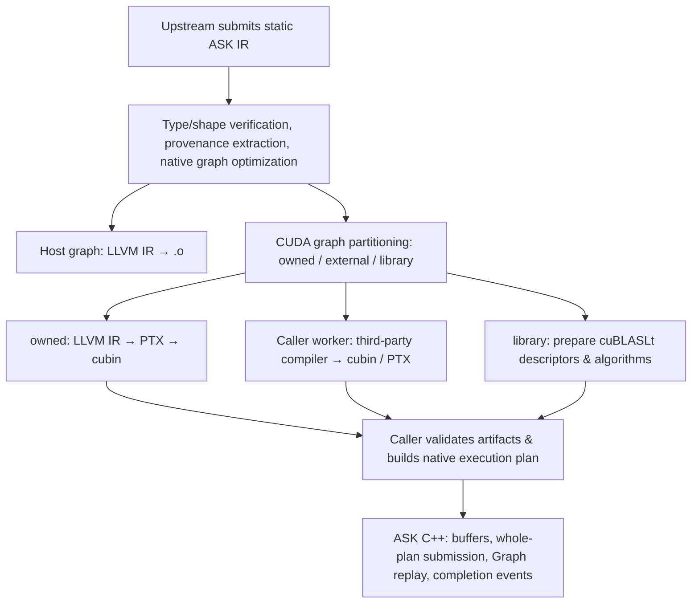

# ASK Compiler Core Concepts

Navigation: [Documentation Index](README.md) · Upstream Collaboration: [FugaTensor Architecture Overview](../../../fugatensor/docs/en/architecture/README.md)

ASK compiles static tensor graphs into CPU or CUDA machine code and schedules external cubin/PTX kernels. The graph captures types, shapes, and data dependencies, while the runtime manages buffers and execution order.

## 1. Division of Labor with Upstream Frameworks

FugaTensor is responsible for Tensor APIs, graph construction, functional `grad`, and Python control flow. `grad` first constructs derivative expressions while numerical execution remains deferred. When reading standard or gradient results, evaluating scalar conditions, or invoking `evaluate`, it collects dependencies and submits a single basic-block graph with concrete shapes to ASK.

ASK is responsible for graph verification, optimization, code generation, and device scheduling. FugaTensor's native extension links directly against ASK C++ libraries while managing third-party workers and disk caching.

Engineering details: [Division of Responsibilities](fugatensor.md#division-of-labor) · [C++ Interface Boundaries](build.md#python-sdk)

## 2. Boundaries of Two-Level IR

The high-level MLIR `ask` dialect describes tensor computations and external operator invocations. `prepare` verifies types, infers shapes, and extracts and erases `ask.mark` annotations. Native operators are then lowered to LLVM IR to generate CPU or CUDA code.

Elementwise inputs must have identical shapes and types; type conversions use `ask.cast`, and scalar splatting uses `ask.splat`. Broadcasts, transpositions, and reductions each have dedicated primitives; `ask.matmul` expresses matrix multiplication against batches of matrices. Host uses `bool/i32/i64/f32/f16`; `bf16` targets CUDA `sm_80+`. External operators integrate into the runtime via cubin/PTX.

Engineering details: [IR Structure and Types](ir.md#ir-structure) · [Numerical Conversions](ir.md#cast-semantics) · [Tensor Primitives](ir.md#tensor-primitives) · [Matrix Multiplication](ir.md#matmul-semantics) · [Shapes and Provenance Markers](ir.md#shape-and-markers)

## 3. Standalone Build and Native Interfaces

`python3 tools/fetch_deps.py` prepares LLVM/MLIR and native OpenBLAS SDKs, and `cmake --preset core` configures the C++ SDK and CLI.

`ASK::Compiler` accepts MLIR text and named options, returning corresponding result types for prepare, partition, and codegen; shapes, external requests, execution plans, ABIs, and artifacts are exposed through dedicated fields, while diagnostics preserve provenance and statistics. `ASK::Runtime` manages device execution. Use `ASK::Core` when directly manipulating MLIR/LLVM. The command-line tool `ask-opt` provides equivalent compilation steps and full JSON reports.

Engineering details: [Standalone Installation](install.md) · [User API](api.md#api-entrypoints) · [Build Workflow](build.md#build-workflow) · [Worker Configuration](artifacts.md#worker-interface)

## 4. Optimization and Code Generation for Native Operators

ASK performs constant and type folding, dead code elimination, and multi-output elementwise fusion on native computations. Elementwise floating-point multiplications and additions preserve their original ordering and are rounded independently.

The Host backend places elementwise computations of identical shapes into shared loops to generate `.o`; f32 matmul invokes OpenBLAS SGEMM. The CUDA backend generates LLVM IR with 64-bit grid-stride loops, which is then lowered into cubin via `llc` and `ptxas`. Broadcasts and transpositions participate in fusion via index mapping; reduction results are materialized when subsequently expanded. CUDA matmuls are dispatched to cuBLASLt, with algorithms and scratchpad configurations frozen during the preparation phase.

Engineering details: [High-Level Optimization](codegen.md#graph-passes) · [Host Code Generation](codegen.md#host-codegen) · [Native CUDA Lowering](codegen.md#owned-cuda) · [Primitives and Matrix Multiplication Verification](matmul_report.md#fusion-profile)

## 5. External Artifacts and Execution Interface

Each external operator maps to an independent kernel. ASK exports compilation requests from the graph; callers hand them to workers, obtain cubin/PTX and launch metadata, validate them, and incorporate them into the execution plan.

`P → external F → Q` forms three steps: P and Q are compiled by ASK, while F is generated by a third-party compiler. Steps exchange data via device buffers; external kernels retain the numerical policies of their respective compilers.

Engineering details: [Artifacts and Ports](artifacts.md#binary-artifact) · [Worker Protocol](compilers.md#worker-protocol)

## 6. Resident Runtime and Caching

`Session` holds CUDA context, streams, and loaded modules. `DeviceBuffer` manages or borrows device memory; `PreparedProgram` submits the entire plan, returning an `Event` covering all steps. ASK PASS verifies the lifetime of shared physical slots for intermediate buffers during preparation and caches successful verifications. Workspaces retain parameter templates and update public port addresses upon submission; workspaces and events are reused upon completion, while outputs persist until released by the caller.

CUDA Graph connects nodes based on read-write dependencies, preserving parallel execution opportunities for independent branches. The preparation phase validates the complete access order of shared slots; upon submission, input and output addresses are updated, and the execution graph is replayed. In-flight invocations maintain their own workspaces. FugaTensor's CUDA JIT uses this path, with the binding layer handling CAI descriptors and Python object lifetime management.

FugaTensor caches compilation artifacts based on tooling, dependencies, and content digests; ASK caches loaded modules and execution resources. PTX is JIT-compiled upon driver loading.

Engineering details: [Session](runtime.md#execution-session) · [Device Tensors](runtime.md#device-tensor-and-cai) · [Caching](runtime.md#two-tier-cache) · [Dependency Scheduling and Workspace Reuse Verification](workspace_report.md)

## 7. Compilation and Execution Pipeline

Engineering details: [Partition Representation](partitioning.md#partition-ir) · [Compilation Packages and Execution](partitioning.md#program-runtime)

## 8. Test Verification

`ask-core`, `ask-compiler`, `ask-primitives`, and `ask-pass` verify graph preparation, optimization, code generation, and plan proofs; `ask-host-blas` verifies OpenBLAS linking and numerical correctness; when `ASK_TEST_CUDA=ON` is enabled, `ask-runtime` verifies GPU execution, slot reuse, and Graph replay; builds with cuBLASLt enabled also run the `ask-matmul` matrix. [FugaTensor](../../../fugatensor/README.md) provides integration examples and end-to-end tests.

Engineering details: [Testing Suite](testing.md#ctest-targets) · [Compilation and Execution Capabilities](fugatensor.md#implemented-scope) · [Project Dependencies](fugatensor.md#roadmap)

## 9. Graph Partitioning and Multi-Kernel Execution Plans

Partitioning produces a set of MLIR functions, with JSON v1 recording buffers, ports, dependencies, and execution order. Native regions fuse internally, while each external node and matmul executes separately. All steps are submitted to the same stream, and intermediate results reside in GPU memory.

Engineering details: [Partition Representation](partitioning.md#partition-ir) · [JSON v1](partitioning.md#plan-v1) · [Plan Rule Proofs](verification.md#plan-proof) · [Resident Scheduling](partitioning.md#program-runtime)
