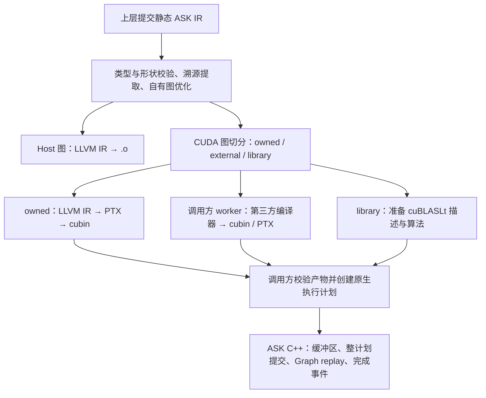

# ASK 编译器核心思想

目录导航：[文档目录](README.md) · 上层协同：[FugaTensor 架构总览](../../../fugatensor/docs/zh/architecture/README.md)

ASK 将静态张量图编译成 CPU 或 CUDA 代码，并调度外部 cubin/PTX。图中记录类型、形状和数据依赖，运行时管理缓冲区和执行顺序。

## 1. 与上层框架的分工

FugaTensor 负责 Tensor API、组图、函数式 `grad` 和 Python 控制流。`grad` 先构造导数表达式，数值执行保持延迟。读取普通结果或梯度结果、判断标量条件或调用 `evaluate` 时，它收集依赖，向 ASK 提交形状确定的单基本块图。

ASK 负责图校验、优化、代码生成和设备调度。FugaTensor 的扩展直接链接 ASK C++ 库，同时管理第三方 worker 和磁盘缓存。

工程细节：[职责划分](fugatensor.md#division-of-labor) · [C++ 接口边界](build.md#python-sdk)

## 2. 双层 IR 的边界

高层 MLIR `ask` dialect 描述张量计算和外部算子调用。`prepare` 检查类型、推导形状、提取并擦除 `ask.mark` 标记。自有算子随后降级到 LLVM IR，生成 CPU 或 CUDA 代码。

逐元素输入须同形状、同类型；类型转换使用 `ask.cast`，标量填充使用 `ask.splat`。广播、转置和归约各有独立原语；`ask.matmul` 表达矩阵与同批次矩阵相乘。Host 使用 `bool/i32/i64/f32/f16`；`bf16` 用于 CUDA `sm_80+`。外部算子通过 cubin/PTX 接入运行时。

工程细节：[IR 结构与类型](ir.md#ir-structure) · [数值转换](ir.md#cast-semantics) · [张量原语](ir.md#tensor-primitives) · [矩阵乘法](ir.md#matmul-semantics) · [形状与溯源](ir.md#shape-and-markers)

## 3. 独立构建与原生接口

`python3 tools/fetch_deps.py` 准备 LLVM/MLIR 和原生 OpenBLAS SDK，`cmake --preset core` 配置 C++ SDK 和 CLI。

`ASK::Compiler` 接收 MLIR 文本和具名选项，按准备、分区、代码生成分别返回结果类型；形状、外部请求、执行计划、ABI 和产物使用独立字段，诊断保存溯源与统计。`ASK::Runtime` 管理设备执行。直接操作 MLIR/LLVM 时使用 `ASK::Core`。命令行工具 `ask-opt` 提供相同的编译步骤和完整 JSON 报告。

工程细节：[独立安装](install.md) · [用户 API](api.md#api-entrypoints) · [构建流程](build.md#build-workflow) · [Worker 配置](artifacts.md#worker-interface)

## 4. 自有算子的优化与代码生成

ASK 对自有计算执行常量和类型折叠、死代码消除及多输出逐元素融合。逐元素浮点乘法和加法保留原有顺序，分别舍入。

Host 后端将同形状的多输出计算放入共享循环，生成 `.o`；f32 matmul 调用 OpenBLAS SGEMM。CUDA 后端生成带 64 位 grid-stride 循环的 LLVM IR，再经 `llc` 和 `ptxas` 生成 cubin。广播和转置通过下标映射参与融合；归约结果扩展时物化。CUDA matmul 交给 cuBLASLt，算法与 scratch 在准备阶段固定。

工程细节：[高层优化](codegen.md#graph-passes) · [Host 代码生成](codegen.md#host-codegen) · [自有 CUDA](codegen.md#owned-cuda) · [原语与矩阵乘法验证](matmul_report.md#fusion-profile)

## 5. 外部产物与执行接口

每个外部算子对应一个独立 kernel。ASK 从图中导出编译请求，调用方交给 worker，取得 cubin/PTX 和启动信息，再校验并加入执行计划。

`P → 外部 F → Q` 形成三个步骤：P、Q 由 ASK 编译，F 由第三方编译器生成。步骤通过设备缓冲区传递数据；外部 kernel 保留其编译器的数值策略。

工程细节：[产物与端口](artifacts.md#binary-artifact) · [Worker 协议](compilers.md#worker-protocol)

## 6. 常驻运行时与缓存

`Session` 持有 CUDA context、stream 和已加载模块。`DeviceBuffer` 管理或借用显存；`PreparedProgram` 提交整段计划，返回覆盖所有步骤的 `Event`。ASK PASS 在准备阶段验证中间缓冲区共享物理槽位的生存期，并缓存成功校验。工作区保留参数模板，提交时更新公开端口地址；工作区和事件在完成后复用，输出保留至调用方释放。

CUDA Graph 按读写依赖连接节点，独立分支保留并行机会。准备阶段校验共享槽位的全部访问顺序，提交时更新输入输出地址并重放执行图。在途调用各有自己的工作区。FugaTensor 的 CUDA JIT 使用这条路径，绑定层处理 CAI 描述符和 Python 对象保活。

FugaTensor 按工具、依赖和内容摘要缓存编译产物；ASK 缓存已加载模块和执行资源。PTX 在驱动加载时 JIT。

工程细节：[会话](runtime.md#execution-session) · [设备张量](runtime.md#device-tensor-and-cai) · [缓存](runtime.md#two-tier-cache) · [依赖调度与临时区复用验证](workspace_report.md)

## 7. 编译与执行流水线

工程细节：[分区表示](partitioning.md#partition-ir) · [编译包与运行](partitioning.md#program-runtime)

## 8. 测试验证

`ask-core`、`ask-compiler`、`ask-primitives` 和 `ask-pass` 验证图准备、优化、代码生成与计划证明，`ask-host-blas` 验证 OpenBLAS 链接及数值；启用 `ASK_TEST_CUDA=ON` 后，`ask-runtime` 验证 GPU 执行、槽位复用和 Graph replay；启用 cuBLASLt 的构建另有 `ask-matmul` 矩阵。[FugaTensor](../../../fugatensor/README.zh.md) 提供接入示例和端到端测试。

工程细节：[测试体系](testing.md#ctest-targets) · [编译与执行能力](fugatensor.md#implemented-scope) · [项目依赖](fugatensor.md#roadmap)

## 9. 图切分与多 Kernel 执行计划

分区结果是一组 MLIR 函数，JSON v1 记录缓冲区、端口、依赖和执行顺序。自有区域内部融合，每个外部节点和 matmul 单独执行。所有步骤提交到同一 stream，中间结果留在显存。

工程细节：[分区表示](partitioning.md#partition-ir) · [JSON v1](partitioning.md#plan-v1) · [计划规则证明](verification.md#plan-proof) · [常驻调度](partitioning.md#program-runtime)
