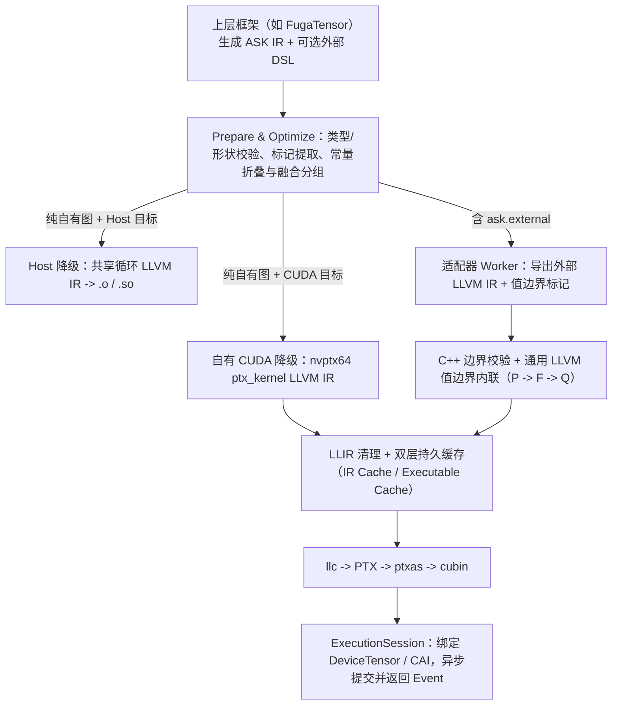

# ASK 编译器核心思想

目录导航：[文档目录](README.md) · 上层协同：[FugaTensor 架构总览](../../fugatensor/docs/architecture/README.md)

做深度学习或科学计算框架时，底层编译往往会遇到一个棘手的问题：框架自己的逐元素算子想走一套干净的图编译器，而用户手写的高性能算子（比如 Triton kernel）又运行在另一套独立的 DSL 编译器里。如果两边只靠全局显存缓冲区和多次 kernel launch 拼起来，中间读写没法消除，类型、精度、流同步和缓存也得维护两套。

ASK 的目标就是把这两条路径收到同一个底层引擎里：**高层用 MLIR 的 `ask` dialect 把计算图、类型精度和外部算子边界说清楚；底层统一落到原生 LLVM IR（允许保留目标 intrinsic 和内联 PTX），在同一份 `llvm::Module` 上完成校验、值边界融合、目标代码生成和常驻运行时调度。**

本文是 ASK 的架构总枢纽。每个章节末尾都链向具体的工程专题，专题顶部也可以随时跳回本文对应小节。

## 1. ASK 与上层框架怎么分工

ASK 不做用户态 Tensor 语法糖，也不维护自动微分磁带——这些工作交给上层框架（例如配套的 [FugaTensor](../../fugatensor/docs/architecture/README.md)）。上层框架可以使用自己独立的中间表示完成追踪、静态展开和求导，最后把一段**形状具体、无动态分支的纯计算图**翻译成基础 ASK IR 交给 ASK。

- **纯自有图**：如果图里全是 `ask.constant`、`ask.splat`、`ask.add`、`ask.mul`、`ask.cast` 等自有算子，ASK 直接把它编译成 CPU 共享库目标文件（`.o` / `.so`）或自有 CUDA `cubin`，不需要安装 Triton、PyTorch 或 NumPy。
- **含外部算子的混合图**：如果上层在图中插入了 `ask.external` 并附上外部 DSL 源码（如用户手写的 `@triton.jit` 函数），ASK 会在编译期调用对应适配器的独立 worker 导出原生 LLVM IR，并在条件满足时把前后自有计算直接内联进外部 kernel。
- **动态控制流归上层**：依赖运行时张量数值的 `if` / `while` 由上层框架切分成多个静态图片段分别提交，已编译好的 kernel 通过缓存直接复用。

工程细节：[FugaTensor 协同与职责边界](07-FugaTensor协同与演进路线.md#division-of-labor)、[前端接入与构建配置](02-前端接入与构建配置.md#python-sdk)。

## 2. 双层 IR：高层管语义，底层用原生 LLVM IR

ASK 内部严格区分两层表示，不做来回折腾的方言转换：

1. **高层 ASK IR（MLIR `ask` dialect）**：负责表达单基本块计算图的数据类型、显式类型转换、具体张量形状、追踪标记（`ask.mark`）以及外部算子的语义契约（`ask.semantics`）与实现声明（`ask.implementation`）。准备阶段（`prepare`）完成类型检查、形状落定和追踪记录提取，随后擦除纯追踪用的 `ask.mark`。
2. **低层 ASK LLIR（原生 `llvm::Module`）**：ASK 不把外部导出的 LLVM IR 倒回 MLIR LLVM Dialect，而是直接用匹配版本的 LLVM Reader 读入原生 `.ll` / bitcode。这样 Triton 等编译器生成的 NVVM intrinsic 和内联 PTX（如 `mov.b32`、`ld.global`、`bar.sync`）可以原封不动保留下来。

整个系统统一支持 6 种基础元素类型：`bool`、`i32`、`i64`、`f32`、`f16`、`bf16`。后端绝不擅自把低精度计算偷偷提升成 `f32`，也不会在整数上假设无符号不溢出；需要混合精度计算时，上层在图里显式写出 `ask.cast`。遇到硬件不支持的类型（例如在 `sm_75` GPU 或无原生 `bf16` 支持的 CPU 上运行 `bf16`），编译器和运行时直接报错，不做静默软件模拟。

工程细节：[ASK IR 结构与类型](01-ASK-IR与数值语义.md#ir-structure)、[单步 RNE 常量与显式类型转换](01-ASK-IR与数值语义.md#cast-semantics)、[形状推导与标记擦除](01-ASK-IR与数值语义.md#shape-and-markers)。

## 3. 轻量构建、进程内绑定与显式适配器白名单

为了让框架和开发者开箱即用，ASK 把构建和调用链路做得尽量直接：

- **统一依赖获取与零参数 Preset**：`python3 tools/fetch_deps.py` 一键拉取并校验锁定在 `cmake/*.lock.json` 中的 LLVM/MLIR SDK 与 `nanobind` 源码。`CMakeLists.txt` 会自动识别 `.deps/` 目录，直接运行 `cmake --preset core` 或 `cmake --preset all` 即可配置构建。
- **进程内 `nanobind` 绑定优先**：Python `ask.Compiler()` 默认通过进程内 C++ 扩展 `_native` 直接调用 MLIR 准备与优化管线，省去临时文件和进程启动开销；同时保留 `ask-opt` CLI 作为命令行工具和跨进程代码生成驱动，并用 `_check_companion()` 校验扩展与 `ask-opt` 属于同一次构建。
- **第三方编译器白名单**：`ASK_THIRD_PARTY_COMPILERS`（`none` / `all` / 分号分隔 ID）对照 `adapters/registry.json` 决定启用哪些适配器。机器上装了 `triton` 包也不会在 `core`（`none`）模式下自动混入构建。

工程细节：[构建流程与 Preset](02-前端接入与构建配置.md#build-workflow)、[可选适配器白名单](02-前端接入与构建配置.md#compiler-selection)、[Python 与 C++ SDK](02-前端接入与构建配置.md#python-sdk)。

## 4. 图优化与自有 CPU / CUDA 代码生成

对于不含外部算子的计算图，ASK 提供一套确定性的高层优化和双后端代码生成管线：

- **高层图优化（`optimize`）**：包含标量常量与 `ask.cast` 折叠、死代码消除，以及多输出逐元素融合组规划（`fusion_groups`）。为了保证跨后端数值可复现，浮点算子不做破坏舍入顺序的代数重结合（例如不把 `(x + a) + b` 改写成 `x + (a + b)`）。
- **Host CPU 降级**：把同一融合组内的多输出逐元素算子合并进同一个线性循环，生成标准 C ABI 入口的目标文件（`.o`），链接成共享库即可在本地直接调用。
- **自有 CUDA 降级**：直接生成 `nvptx64-nvidia-cuda` 原生 LLVM IR（`ptx_kernel`），按元素总数自动选择 32 位或 64 位线性线程索引，支持多输入、多输出、异构输出 dtype、零维标量张量和零元素空张量，经 `llc` + `ptxas` 编译为 `cubin`。

工程细节：[高层图优化规则](03-图优化与自有代码生成.md#graph-passes)、[Host 共享循环代码生成](03-图优化与自有代码生成.md#host-codegen)、[自有 CUDA 降级](03-图优化与自有代码生成.md#owned-cuda)。

## 5. 外部编译器适配与通用 LLVM 值边界融合

以经典的 `P → F → Q` 链路为例：`P`（`t = x + 1`）和 `Q`（`y = u + 3`）是 ASK 自有逐元素计算，`F`（`u = t * 2`）是用户提交的 Triton kernel。ASK 把“理解外部编译器”和“执行 LLVM 内联改写”拆成了职责清晰的两层：

1. **适配器层（`adapters/triton/`）**：固定保持 `F` 原有的线程组织（`grid`、`num_warps`、blocked layout）和数值收缩选项不变。worker 先检查 DSL 是否满足单次受保护输入 load + 纯逐元素计算 + 同索引掩码输出 store，再通过 Triton 公开的 `tl.inline_asm_elementwise` 在值边界插入零开销恒等标记（`mov.pred` / `mov.b16` / `mov.b32` / `mov.b64`），并对比加标记前后的布局与资源完全一致。同时把 `F` 的浮点融合许可落实到 `F` 自己的 LLVM 指令 `contract` 标志上，防止 `P` / `Q` 被连带合成 FMA。
2. **通用 LLVM 值边界内联核心（`lib/LLIR/Inline.cpp`）**：不认识任何 Triton 概念。它只接收经过校验的值边界站点和 ASK 为 `P`、`Q` 生成的 typed helper 函数，在模块副本上完成类型与支配关系检查、模块链接、逐站点内联和标记清除；任何一步校验不过都会完整回滚原模块。

工程细节：[适配器目录与导出协议](04-外部编译器适配与边界内联.md#adapter-architecture)、[通用 LLVM 值边界内联器](04-外部编译器适配与边界内联.md#boundary-inliner)、[Triton 融合与 FMA 隔离](04-外部编译器适配与边界内联.md#triton-fusion)。

## 6. 常驻 CUDA 运行时与双层持久缓存

编译出来的 GPU kernel 不能每次运行都重新初始化上下文、加载模块、拷入拷出主机列表。ASK 用 `libcuda.so.1` 动态加载实现了一套轻量常驻 CUDA 运行时：

- **`ExecutionSession` 与 `DeviceTensor`**：管理设备 primary context 和非阻塞 CUDA stream。数据拷上设备后常驻显存，重复调用 `executable.submit(x, y)` 只做轻量参数校验和 `cuLaunchKernel` 异步入队，返回 `Event` 供按需同步。
- **零拷贝互操作**：支持消费外部框架暴露的 `__cuda_array_interface__`（v2/v3）连续张量，自动插入跨 stream 事件等待，并在后台队列持有 Python 宿主对象引用直到 GPU 执行完毕，避免显存提前释放。
- **IR 与可执行文件双层缓存**：第一层按规范化图与外部环境指纹缓存优化/融合后的 LLVM IR 及元数据；第二层按 LLVM IR、`llc`/`ptxas` 工具指纹与架构选项缓存最终 `cubin`。进程重启后两层缓存都能直接命中。

工程细节：[常驻 ExecutionSession](05-常驻运行时与多级缓存.md#execution-session)、[设备张量与零拷贝互操作](05-常驻运行时与多级缓存.md#device-tensor-and-cai)、[双层持久缓存](05-常驻运行时与多级缓存.md#two-tier-cache)。

## 7. 端到端编译与执行流水线

## 8. 验证方法与演进边界

ASK 的测试不靠为每种精度手写一套近似断言，而是用**同一套共享图构造器 + 独立 Python BigInt / IEEE-754 单步 RNE 参考实现**横跨 CPU、自有 CUDA 和 Triton 融合路径逐位核对 6 种精度与 6×6 类型转换矩阵。

工程细节：[测试分层与共享多精度矩阵](06-工程结构与测试体系.md#ctest-targets)、[当前支持范围与后续路线](07-FugaTensor协同与演进路线.md#implemented-scope)。
