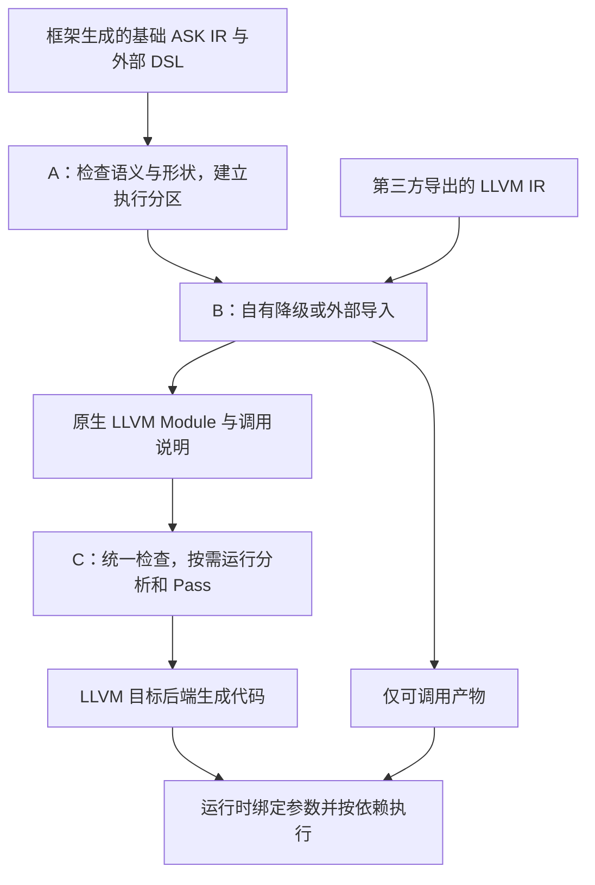

# ASK 编译器核心思想

ASK 要把不同编译器生成的低层代码接到同一套接口上，统一保存、检查、运行 Pass 和生成可执行产物。**这层使用原生 LLVM IR，允许保留目标 intrinsic 和内联汇编，包括 PTX。** 追踪、融合等优化在此基础上按需启用，不是接入条件。

本文是顶层设计，各节链接到工程细节，工程文档也能返回对应章节。[完整目录](README.md)。仓库已有可接入框架的初稿：高层图准备、形状推导、标记提取、自有六类型图及显式 cast 的 host 降级（bf16 检查本机 feature），以及 Triton DSL 导出和原生 LLVM IR 验证。实际 API 与限制见[上层框架接入](10-上层框架接入.md)。[基础优化](11-基础优化与逐元素融合.md)支持常量折叠、死代码消除和自有逐元素多输出融合；[GPU 融合与 IR 缓存](12-GPU融合与IR缓存.md)已实现六类型静态逐元素 ASK→Triton→ASK 原生 LLVM 融合和 GPU 执行，P/Q 可显式转换计算精度。完整混合图调度仍待实现。

<a id="ask-positioning"></a>

## 1. ASK 接手哪一段工作

上层框架负责用户 API、Tensor 对象和自动微分，并生成基础高层 ASK IR，作为 ASK 图编译的输入。框架可以使用自己的内部 IR，但要在框架侧完成到 ASK IR 的转换。ASK 从这份图开始检查语义、推导形状、划分区域、降级和执行。

第三方编译器负责的区域在 ASK IR 中用 `ask.external` 标明，关联语义、编译器及实现引用；上层同时提交该编译器的 DSL。ASK 按引用将 DSL 交给指定编译器，取得原生 LLVM IR，再接到图中的输入输出端口。

图中的操作和依赖在编译时确定。运行时数据决定的图级分支和循环由上层框架处理，再调用对应的已编译图。算子内部的循环、条件判断和掩码仍可以出现在低层代码里。首版先使用静态形状，后续符号维度不改变这个分工。

已经有 LLVM IR 的工具也可以直接使用低层导入接口。只检查或保存模块时，无需知道它对应哪个高层算子；需要语义检查时可以另外提供绑定。这个工具入口不改变图编译的输入约定：图仍由上层以基础 ASK IR 提交，外部区域仍关联对应 DSL 和实现记录。

工程细节：[一次编译怎样经过各阶段](00-总体契约与阶段边界.md)。

<a id="ask-frontends"></a>

## 2. 上层交给 ASK 什么

用下面这条链说明各阶段的分工。P/Q 由 ASK 编译，F 来自外部编译器；它们与 A/B/C 层的字母无关。

```text
P: t[i] = x[i] + 1
F: u[i] = t[i] * 2
Q: y[i] = u[i] + 3
```

每一步按 32 位整数回绕计算，索引范围是 `0 <= i < N`。x 只读，y 使用单独分配，t/u 是内部结果。这些条件用于检查调用和安排存储，不因为尚未启用融合就可以省略。

F 的语义与实现分开注册。语义说明输入输出、类型、形状和读写行为；实现引用说明由哪个编译器生成、怎样导出或调用。这样，框架不必了解外部编译器的内部 Pass，外部适配器也不用重复定义一套算子语义。

接入只使用外部编译器的公开接口、插件或 Pass 扩展点，不改其源码，不依赖私有钩子。按已提交 DSL 与固定配置取得合法调用产物、却拿不到 IR 时，仍可独立执行；这种情况应标明没有低层模块可供改写。

工程细节：[A 层的图和语义注册](01-A层高级IR与区域规划.md)、[第三方接入 API](08-第三方LLIR接入API.md)、[当前 Python/C++ 接入示例](10-上层框架接入.md)。

<a id="ask-architecture"></a>

## 3. 统一层究竟统一什么

**ASK LLIR 就是原生 LLVM IR。** 文本形式为 `.ll`，二进制形式为 LLVM bitcode；读入 ASK 后是 `llvm::Module`。上游可以使用 MLIR，但应在自己的导出路径中完成到原生 LLVM IR 的翻译。ASK 不把 LLVM IR 再导回 MLIR LLVM Dialect。

高层 **ASK IR** 则采用 MLIR 的 `ask` dialect，具体表达 A 层的 `SemanticModule`。它保存张量、算子、形状约束和效果顺序，自有计算逐步降为 LLVM；外部区域的 DSL 由对应编译器处理。两种 IR 的职责及连接方式见 [ASK IR 设计目录](ask-ir/README.md)。

原生模块中可以同时存在普通 LLVM 指令、目标 intrinsic 和 `call asm`。LLVM 本身支持这种表示；例如 Triton 导出的 `llir` 已经是原生 LLVM IR，其中可以保留内联 PTX。[LLVM 内联汇编](https://llvm.org/docs/LangRef.html#inline-assembler-expressions)、[Triton 导出实现](https://github.com/triton-lang/triton/blob/b89bce47e2d9e1c7fb4bd568c1e55e19c476a31e/third_party/nvidia/backend/compiler.py#L492-L544)

ASK 不要求把这些操作全部改写成同一套通用指令。只要 LLVM reader 能读取模块，模块本身合法，就可以进入统一的存储、检查和 Pass 接口。能否生成代码还要由目标后端检查；含 PTX 的模块依然需要相应目标支持。

这条路径覆盖能够导出原生 LLVM IR 的实现。仅能导出其他格式的编译路径，可以先通过独立调用接入图，不能算作 LLVM IR 接入。统一接口也不会自动把 PTX 变成可在其他硬件上执行的代码。

一份可执行的低层产物还需要入口参数、目标、依赖库和调用或启动方式。这些信息未必全在 LLVM Module 中，所以随 IR 一起保存。索引映射、线程间传值关系等进一步分析信息可以缺省，需要它们的 Pass 再请求计算或补充。

由此分开三个问题：模块是否读入成功；是否具备生成和执行代码所需的信息；某个具体优化是否能够安全运行。不能用一个“可融合”标签替代这三个判断。

工程细节：[阶段之间传什么](00-总体契约与阶段边界.md)、[产物字段和导入结果](08-第三方LLIR接入API.md)。

<a id="ask-a"></a>

## 4. A 层：把计算图和调用关系说清楚

A 层检查 P/F/Q 的类型和形状能否连接，记录每个结果的使用者，再补上数据连线没有表达的读写顺序。例如 F 修改一个共享状态，就不能仅因没有张量依赖而被任意移动。

检查通过后，先得到分别执行 P/F/Q 的分区。它说明谁先完成、哪些结果需要存储、最后返回什么。B 层随后为各区域取得或生成实现。

如果本次启用了需要高层信息的优化，A 层再提供对应的候选与分析。例如融合 Pass 会查询 t/u 是否还有其他使用者。关闭融合时，不必为了构建这张正常执行的图运行完整融合规划。

输出图称为 `SemanticModule`，执行分区及按需生成的候选放在 `RegionPlan` 中。高层端口有稳定身份，方便以后与低层参数关联；它不要求现在就定位到每一条访存。

形状从 ASK IR 的类型和算子规则推导，降级前冻结为形状快照，随后通过端口、存储和物理参数绑定保留。纯追踪标记 `ask.mark` 透传同一个值，收集记录后清除；形状和正常调用不依赖它存活。它与表示外部计算边界的 `ask.external` 分工不同。

工程细节：[A 层高级 IR 与区域规划](01-A层高级IR与区域规划.md)、[ASK IR 结构与操作](ask-ir/00-结构类型与操作.md)、[形状推导](ask-ir/02-形状推导与约束.md)、[标记算子](ask-ir/01-标记算子与追踪.md)。

<a id="ask-b"></a>

## 5. B 层：取得代码，整理成相同的产物格式

B 层负责 ASK 自有降级和外部导入。两条路径最终都交出原生 LLVM Module 及调用说明，后续不再按“这是哪个前端生成的”选择两套管理方式。

首期只接 Triton。各编译器导出阶段、参数消除、启动信息和工具链版本都不同，先把一个真实工具链的完整流程做好。Triton 的适配器负责取得 `asm["llir"]`，记录实际参数、目标和启动信息，保留其中的 PTX；ASK 使用 LLVM reader 直接读入。

第三方导出的计算职责是 `export(request) -> LLIRArtifact`。适配器的 worker、环境与缓存策略、原生边界检查、构建规则和测试都集中在 `adapters/<id>/`；公共核心通过接口调用它，不解析某个编译器的私有字段。已经有 LLVM 文件时可以直接导入检查。仅导出不要求支持融合；融合需要适配器另外交付已经检查过的值边界。

模块含有 ASK 暂时不能解释的内联汇编，并不自动导致导入失败。如果目标后端能生成代码、调用信息也齐全，就可以保持原样编译执行。只有需要理解那段汇编的优化才会受限。

外部 F 的既有执行策略保持固定。后续若尝试融合，只调整 ASK 自有的 P/Q 来适应它；不能为取得更好的融合结果要求 F 改布局、线程组织或数值模式。

工程细节：[B 层多源降级与导入](03-B层多源降级与低层归一化.md)、[ASK IR 降级与形状保留](ask-ir/03-降级与信息保留.md)、[第三方 LLIR 接入 API](08-第三方LLIR接入API.md)、[当前适配器接口、注册与目录](17-第三方编译器适配与注册.md)。

<a id="ask-c"></a>

## 6. C 层：在同一份 LLVM IR 上组织分析和 Pass

C 层接收模块后，可以检查结构、查看调用关系、查询资源、运行局部优化，也可以在信息足够时运行跨区域优化。每个 Pass 说明自己需要哪些事实；缺少事实时跳过对应变换，报告缺什么。

例如，统计入口和符号不需要知道 PTX 内部怎样访存。修改一条与它无关的普通 LLVM 算术指令，可以使用 LLVM 的既有规则；若想把访存移过这段汇编，就必须正确处理其副作用。不能笼统认为“未知操作只影响自己”。

跨层追踪是其中一项分析：从高层的 t 出发，找到它在低层对应的参数、地址和访问。普通指令可由 ASK 分析，额外说明可由适配器提供。信息不足时返回未知，不能伪造精确结果。

融合也是一个可选 Pass。它要证明 F 的读取对应 P 的哪个结果、这个值是否已经产生、掩码是否相容，以及删除 t 后是否仍满足其他使用者。通过之后才能替换读取、删除不再需要的存储。允许模块保留内联 PTX，并不意味着自动允许删除其中的读写。

当前实现把两项工作分开：适配器或分析提供有合法性依据的值边界，通用 LLVM 核心负责类型/支配检查、helper 行为检查、链接、内联和失败回滚。核心接收整数、浮点或定长向量，可以处理多参数与多个站点，不写入 Triton 版本、block 或 warp 条件。接口与验证见[第 13 章](13-通用LLVM值边界内联.md)。

元素类型由上层 ASK IR 决定，沿降级、外部签名和运行缓冲区传递。bool、i32、i64、f32、f16、bf16 共用 `run` 入口。每个 SSA 值有明确类型；框架用 `ask.cast` 写出转换，形状保持不变。低精度存储、f32 中间计算、最终窄化必须在图中显式表达，后端不自行提升精度。浮点融合还要保留各区域的数值约定：F 允许 FMA，不代表 ASK 的乘加也允许合成一步；外部编译器留在代码生成选项中的许可，要先落实到 F 自己的指令上。类型链见[框架接入](10-上层框架接入.md#dtype-path)，cast 的舍入、饱和、bool 存储及混合精度规则见[类型转换与混合精度](15-类型转换与混合精度.md)，Triton 的具体处理见[GPU 融合](12-GPU融合与IR缓存.md)。

正确性测试共用图定义，再遍历 dtype、输入样本和执行后端。精度差异体现在类型与舍入规则中，不靠为每种精度维护另一份算子实现。bf16 执行要求实际 CPU/GPU 支持，包括仅在中间值使用 bf16 的情况；不支持就明确报错。共用图、独立数值参考和硬件拒绝测试见[多精度测试](14-多精度测试.md)。

Triton 是其中一个提供方：它通过 DSL 数据流分析和公开 identity 标记建立边界，核对实际地址与掩码，再交给同一个内联核心。ASK 生成 P/Q helper，保留 F 的原访存和执行策略。未知 DSL 结构仍可阻止这一次融合，但不成为所有编译器接入时的限制。GPU 路径、缓存键和数值验证见[第 12 章](12-GPU融合与IR缓存.md)。

改写在副本中进行，检查通过才提交。无法证明某项优化正确时保留原模块；输入损坏或变换生成非法 IR 时返回相应错误。代码生成阶段也可能因资源限制拒绝优化后的方案，届时恢复原来的合法版本。

工程细节：[C 层统一处理与可选优化](04-C层统一处理与可选优化.md)、[按需追踪](02-跨层身份与追踪契约.md)。

<a id="ask-pipeline"></a>

## 7. 生成代码，再按调用计划执行



关闭所有可选优化时，仍然可以沿这条路径完成编译。已有可调用产物保留独立调用，LLVM Module 直接交目标代码生成器。

运行时需要知道参数类型、数组步长、缓冲区所有权和完成事件。提交一个异步任务不表示结果已经可读；消费者和释放操作必须等待所需事件。

以后若某项优化只适用于特定形状或布局，在执行前检查条件，再选择合法版本。执行已经写出结果或修改外部状态后出错，不能换一个版本自动重跑整图。

框架可以把张量保留在设备上，通过同一个 Session 重复提交已加载的可执行产物。Python 只传递设备句柄和参数；完成事件负责表明何时可读结果、何时能释放资源。磁盘缓存保存可重载的机器码，进程内缓存保存当前上下文的模块，两者不能混用。

工程细节：[代码生成与运行时](05-代码生成与运行时.md)、[Python 绑定、设备张量和常驻执行](16-Python绑定与常驻运行时.md)。

<a id="ask-minimal-loop"></a>

## 8. 首期怎样算做完

先选定 Triton 版本和一个实际目标：导出 F 的原生 LLVM IR，经过 ASK 解析和检查，绑定参数与启动信息，再由目标后端生成代码并运行。包含内联 PTX、没有完整追踪表的模块也要覆盖。这条路径成功，才证明统一低层接入已经跑通。

随后把 P/F/Q 放进同一执行计划，验证正常的数据传递和生命周期。完整追踪与融合单独验收；没有把三个区域融合成一个 kernel，不影响前面的接入结论。

首期不要求接入第二种真实编译器。通用 API 可以用离线 LLVM 文件和测试夹具验证，但真实 Triton 的导出与执行测试不能用模拟结果替代。

工程细节：[实施路线与端到端示例](07-实施路线与端到端示例.md)、[ASK IR 与 Triton DSL 贯穿示例](ask-ir/04-示例与验证.md)。

<a id="ask-engineering"></a>

## 9. 改写后怎样避免继续使用旧信息

IR、调用说明和分析结果分别带版本。一次 Pass 改了索引，旧的访问映射就不能继续使用；链接、克隆或内联改变了指令引用，也要重新绑定或重算。可选追踪表可以没有，但已有表不能与当前代码矛盾。

保存的编译记录包括输入产物、工具链版本、实际配置、运行过的 Pass 和失败原因。结构检查、调用检查与优化正确性检查分别进行，不能把 LLVM verifier 通过当成整个程序已经算对。

当前保留 A/B/C 三层，不设 D 层。是否增加某个 Pass，取决于它解决什么具体问题及需要哪些条件，不要求再为它增加一个架构层。

构建时可以关闭全部第三方编译器、启用全部已支持适配器，或只选指定编译器。这里指 Triton 这类 DSL 编译器；LLVM/MLIR 和薄的 nanobind Python 绑定都是 ASK 的基础组成，`none/all/triton` 全部保留，不设独立的绑定开关；目标后端另外选择。关闭第三方支持后保留自有算子编译和原生 LLVM 工具入口；编译含未启用 external 的图时明确报错，不自动加载系统里的编译器。

工程细节：[工程组织、Pass 管理和测试](06-工程组织与验证.md)、[构建模式、依赖与安装](09-构建与可选编译器.md)、[适配器与核心的依赖方向](17-第三方编译器适配与注册.md#1-一种编译器一个目录)。

## 10. FugaTensor 放在哪里

FugaTensor 的首个 Python 原型位于同级 `fugatensor/` 仓库。它提供 `tensor`、`@jit`、加法、乘法和显式类型转换，追踪时直接生成基础 ASK IR。CPU 计算由 ASK 生成并即时加载本机代码；Triton 算子作为 external 提交 DSL，由 ASK 完成 LLVM 融合和 CUDA 执行。它目前没有自动微分或另一套自身 IR，图级数据依赖控制尚未实现。

ASK 自己应能构图、导入 LLVM 模块、编译和执行。其他框架接入时不必接受 FugaTensor 的对象模型。具体接入见 [A 层](01-A层高级IR与区域规划.md)，调用方式见[代码生成与运行时](05-代码生成与运行时.md)。FugaTensor 的实际接口与演示见[上层张量库接入示例](18-FugaTensor接入示例.md)。
