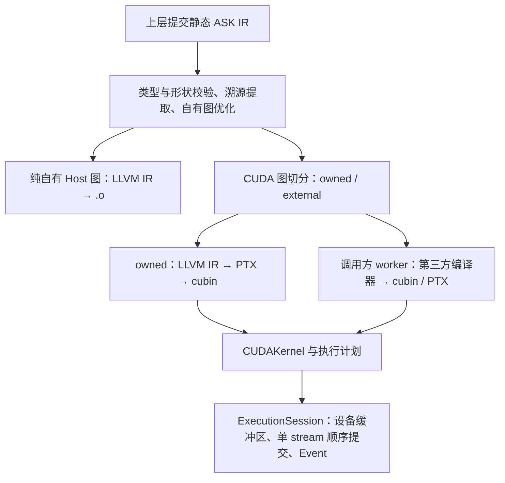

# ASK 编译器核心思想

目录导航：[文档目录](README.md) · 上层协同：[FugaTensor 架构总览](../../fugatensor/docs/architecture/README.md)

ASK 接收静态张量图，将自有计算编译成 CPU 或 CUDA 代码，并把外部 CUDA 产物纳入统一执行计划。高层图保存类型、形状和数据依赖；自有算子在 LLVM 层生成机器码，外部算子由调用方的编译器生成 cubin 或 PTX。

## 1. 与上层框架的分工

Tensor API、自动组图、自动微分与动态控制流由上层框架处理。FugaTensor 在读取数据、标量条件判断、反向传播或显式求值时，收集所需依赖并提交形状确定的单基本块 ASK 图。

ASK 负责图校验、自有算子优化与代码生成、外部产物校验、显存管理和 kernel 调度。第三方 DSL 的编译器调用、源码检查和版本约束属于调用方；FugaTensor 在自己的包内维护 Triton worker，ASK 的构建和安装不依赖它。

工程细节：[职责划分](07-FugaTensor协同与演进路线.md#division-of-labor) · [Python SDK](02-前端接入与构建配置.md#python-sdk)

## 2. 双层 IR 的边界

高层 MLIR `ask` dialect 表达显式类型、静态形状、`ask.mark` 溯源和 `ask.external` 端口契约。`prepare` 完成类型检查、形状推导和标记提取，随后擦除透传标记。低层原生 LLVM IR 用于 ASK 自有 CPU/CUDA 降级及独立的 LLVM 校验、清理工具。

外部产物通过可执行接口进入运行时，不经过 ASK LLVM 内联。张量端口支持 `bool`、`i32`、`i64`、`f32`、`f16`、`bf16`，不做隐式类型提升或广播；混合精度通过 `ask.cast` 显式表达。`bf16` 计算要求对应硬件能力。

工程细节：[IR 结构与类型](01-ASK-IR与数值语义.md#ir-structure) · [数值转换](01-ASK-IR与数值语义.md#cast-semantics) · [形状与溯源](01-ASK-IR与数值语义.md#shape-and-markers)

## 3. 独立构建与进程内绑定

`python3 tools/fetch_deps.py` 获取锁定的 LLVM/MLIR 和 nanobind；`cmake --preset core` 构建自有 CPU/CUDA 编译器、原生 Python 绑定和常驻运行时。ASK 不提供第三方编译器构建开关或注册白名单。

Python `Compiler()` 在进程内完成图准备、优化和切分；代码生成需要伴生 `ask-opt` 时，先检查 CLI 与原生扩展的完整 capabilities 一致。外部 worker 通过 `CompilerEnvironment` 显式配置，与 ASK 构建解耦。

工程细节：[独立安装](安装.md) · [用户 API](用户API.md#api-entrypoints) · [构建流程](02-前端接入与构建配置.md#build-workflow) · [Worker 配置](04-外部产物与执行接口.md#worker-interface)

## 4. 自有算子的优化与代码生成

常量和类型折叠、死代码消除及多输出逐元素融合只作用于 ASK 自有计算。浮点运算保留原有顺序，自有乘法和加法分别舍入。

Host 后端把同一融合组中的同形状多输出计算放入共享循环，生成 `.o`。CUDA 后端把自有区域降级为带 64 位 grid-stride 循环的 NVPTX LLVM IR，经 `llc` 与 `ptxas` 生成 cubin。两条路径支持显式混合精度；CUDA 路径还支持异构多端口、0-D 张量和空张量。

工程细节：[高层优化](03-图优化与自有代码生成.md#graph-passes) · [Host 代码生成](03-图优化与自有代码生成.md#host-codegen) · [自有 CUDA](03-图优化与自有代码生成.md#owned-cuda)

## 5. 外部产物与执行接口

每个外部算子是独立 kernel。Worker 接收协议 v2 请求，返回 cubin 或 PTX、入口、目标架构、启动配置及物理参数绑定。ASK 从图中推导张量 ABI，不要求第三方导出 LLVM IR，也不合并外部与自有 kernel。

`P → 外部 F → Q` 因此形成三个步骤：P、Q 分别使用 ASK 自有代码生成，F 使用第三方产物。步骤之间的数据保存在设备缓冲区，通过指针连接；外部数值策略由其生产者决定。

工程细节：[产物与端口](04-外部产物与执行接口.md#binary-artifact) · [Worker 协议](09-外部编译器适配接入规范.md#worker-protocol)

## 6. 常驻运行时与缓存

`ExecutionSession` 持有 primary context、非阻塞 CUDA stream 与已加载模块。`DeviceTensor` 保存常驻显存，提交返回异步 `Event`。外部连续张量可通过 CUDA Array Interface 借用，运行时建立生产者流依赖并保留宿主对象引用。

自有 CUDA 使用 LLVM IR 和 cubin 两层缓存；外部路径缓存 worker 返回的可执行产物，每次查找前探测生产者与依赖身份。缓存和编译包均检查内容摘要。PTX 在 CUDA 驱动加载时 JIT，不经过 ASK 的 `llc` 或 `ptxas`。

工程细节：[会话](05-常驻运行时与多级缓存.md#execution-session) · [设备张量](05-常驻运行时与多级缓存.md#device-tensor-and-cai) · [缓存](05-常驻运行时与多级缓存.md#two-tier-cache)

## 7. 编译与执行流水线

工程细节：[分区表示](08-图切分与多Kernel执行计划.md#partition-ir) · [编译包与运行](08-图切分与多Kernel执行计划.md#program-runtime)

## 8. 验证与支持边界

`ask-unit` 验证图语义、自有代码生成、通用 worker 协议、缓存和计划契约；`ask-gpu` 验证真实设备执行。自有 CPU/CUDA 共用六种类型和 6×6 转换的独立数值参考。第三方编译器专属测试由调用方维护，缺少环境而跳过的测试不能作为功能通过的证据。

工程细节：[测试体系](06-工程结构与测试体系.md#ctest-targets) · [已实现范围](07-FugaTensor协同与演进路线.md#implemented-scope) · [当前限制](07-FugaTensor协同与演进路线.md#roadmap)

## 9. 图切分与多 Kernel 执行计划

高层分区以带 kernel 身份的 MLIR 函数保存。JSON v1 记录逻辑缓冲区、端口、生产者依赖和执行顺序。自有区域内部继续融合，每个外部节点保持独立；所有步骤在同一会话 stream 上顺序提交，中间结果留在显存。

工程细节：[分区表示](08-图切分与多Kernel执行计划.md#partition-ir) · [JSON v1](08-图切分与多Kernel执行计划.md#plan-v1) · [常驻调度](08-图切分与多Kernel执行计划.md#program-runtime)
