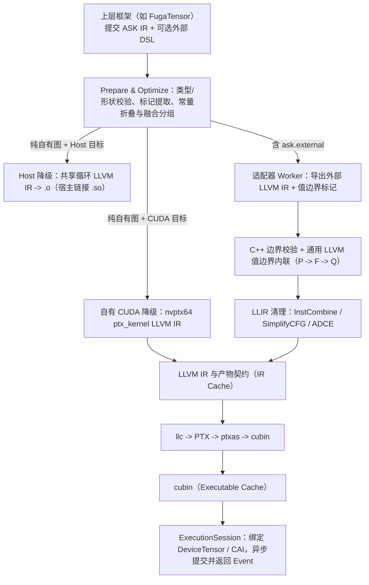

# ASK 编译器核心思想

目录导航：[文档目录](README.md) · 上层协同：[FugaTensor 架构总览](../../fugatensor/docs/architecture/README.md)

张量框架通常同时包含两类计算：框架自身的逐元素图算子，以及用户通过外部 DSL（如 Triton）编写的算子。如果两类算子只通过全局显存缓冲区和多次 kernel launch 拼接，中间读写无法消除，类型转换、流同步和编译缓存也需要各自维护一套。

ASK 将这两条路径接入同一套底层管线：高层用 MLIR `ask` dialect 表达静态计算图、精确类型和外部算子边界；低层统一落到原生 LLVM IR（保留目标 intrinsic 和内联 PTX），在 `llvm::Module` 上完成校验、值边界融合与目标代码生成，CUDA 产物再交给常驻会话执行。

## 1. 与上层框架的分工

ASK 不负责用户态 Tensor API 或自动微分图构建，这些由上层框架（如 [FugaTensor](../../fugatensor/docs/architecture/README.md)）处理。上层在自身中间表示上完成追踪、控制流展开和求导后，将形状确定、无动态分支的单基本块计算图翻译为 ASK IR 提交。

- **纯自有图**：仅含 `ask.constant`、`ask.splat`、`ask.add`、`ask.mul`、`ask.cast` 等自有算子时，ASK 直接生成 CPU 目标文件（`.o`）或自有 CUDA `cubin`，不依赖 Triton、PyTorch 或 NumPy。
- **含外部算子的混合图**：当前 CUDA 编译入口支持围绕一个 `ask.external` 的单输入单输出、非空且同形状同存储类型的逐元素图；适配器的独立 worker 导出原生 LLVM IR，经边界检查后把前后自有计算内联进外部 kernel。结构或证明不满足时会报错，没有自动拆分多 kernel 的回退路径。
- **动态控制流**：依赖运行时张量数值的 `if` / `while` 由上层框架切分为多个静态图片段分别提交，已编译的 kernel 通过缓存复用。

工程细节：[FugaTensor 协同与职责边界](07-FugaTensor协同与演进路线.md#division-of-labor) · [前端接入与构建配置](02-前端接入与构建配置.md#python-sdk)

## 2. 双层 IR：高层管图语义，底层用原生 LLVM IR

1. **高层 ASK IR（MLIR `ask` dialect）**：表达单基本块计算图的元素类型、显式转换、静态形状、追踪标记（`ask.mark`）以及外部算子的语义声明（`ask.semantics`）与实现声明（`ask.implementation`）。前端 `prepare` 完成类型检查、形状推导和追踪记录提取，随后擦除 `ask.mark`。
2. **低层 ASK LLIR（原生 `llvm::Module`）**：直接用匹配版本的 LLVM Reader 读入外部或自有降级产出的 `.ll`，不绕回 MLIR LLVM Dialect，从而保留 Triton 等编译器生成的 NVVM intrinsic 与内联 PTX（如 `mov.b32`、`ld.global`、`bar.sync`）。

全链路支持 6 种基础元素类型：`bool`、`i32`、`i64`、`f32`、`f16`、`bf16`。后端不做隐式类型提升，混合精度需在图中显式插入 `ask.cast`。目标硬件不支持某类型（如在低于 `sm_80` 的 GPU 或无原生 `bf16` 支持的 CPU 上使用 `bf16`）时直接报错，不做软件模拟。

工程细节：[ASK IR 结构与类型](01-ASK-IR与数值语义.md#ir-structure) · [单步 RNE 常量与显式类型转换](01-ASK-IR与数值语义.md#cast-semantics) · [形状推导与标记擦除](01-ASK-IR与数值语义.md#shape-and-markers)

## 3. 构建、进程内绑定与适配器白名单

- **依赖拉取与 CMake Preset**：`python3 tools/fetch_deps.py` 拉取并校验锁定在 `cmake/*.lock.json` 中的 LLVM/MLIR SDK 与 `nanobind` 源码。`CMakeLists.txt` 自动识别 `.deps/` 目录，直接执行 `cmake --preset core` 或 `cmake --preset all` 即可配置构建。
- **进程内 `nanobind` 绑定**：Python `ask.Compiler()` 默认通过进程内 C++ 扩展 `_native` 执行 `prepare` 与 `optimize`；需要调用外部 `ask-opt` 生成目标代码时，通过 `_check_companion()` 核对扩展与 `ask-opt` 的构建指纹一致。
- **第三方编译器白名单**：`ASK_THIRD_PARTY_COMPILERS`（`none` / `all` / 分号分隔 ID）对照 `adapters/registry.json` 决定启用哪些适配器；本机已安装的 Python 包不会在 `core`（`none`）模式下自动接入构建。

工程细节：[独立安装](安装.md) · [构建流程与 Preset](02-前端接入与构建配置.md#build-workflow) · [可选适配器白名单](02-前端接入与构建配置.md#compiler-selection) · [Python 与 C++ SDK](02-前端接入与构建配置.md#python-sdk)

## 4. 图优化与自有 CPU / CUDA 代码生成

对不含外部算子的计算图，ASK 执行确定性高层优化与双后端降级：

- **高层图优化（`optimize`）**：包含标量常量与 `ask.cast` 折叠、死代码消除，以及多输出逐元素融合分组（`fusion_groups`）。浮点算子不做改变舍入顺序的代数重结合（如不把 `(x + a) + b` 改写为 `x + (a + b)`）。
- **Host CPU 降级**：将同一融合组内的多输出逐元素算子合并进同一线性循环，生成标准 C ABI 目标文件（`.o`）。
- **自有 CUDA 降级**：生成 `nvptx64-nvidia-cuda` 原生 LLVM IR（`ptx_kernel`），使用 64 位 grid-stride 循环，支持多输入、异构 dtype 多输出、0-D 标量与空张量，经 `llc` + `ptxas` 生成 `cubin`。

工程细节：[高层图优化规则](03-图优化与自有代码生成.md#graph-passes) · [Host 共享循环代码生成](03-图优化与自有代码生成.md#host-codegen) · [自有 CUDA 降级](03-图优化与自有代码生成.md#owned-cuda)

## 5. 外部编译器适配与通用 LLVM 值边界融合

对于 `P: t = x + 1 → F: Triton kernel (u = t * 2) → Q: y = u + 3` 这类混合链路，外部编译器解析与 LLVM IR 内联分为两层：

1. **适配器层（`adapters/triton/`）**：保持 `F` 原有的线程组织（`grid`、`num_warps`、blocked layout）与浮点收缩设置不变。worker 检查源码满足单次受保护输入 load、纯逐元素计算与同索引掩码输出 store 后，通过 `tl.inline_asm_elementwise` 在值边界插入恒等位复制标记（`mov.pred` / `mov.b16` / `mov.b32` / `mov.b64`），并对比加标记前后的布局与资源一致。`F` 的浮点融合策略写入 `F` 自身 LLVM 指令的 `contract` 标志，不波及 `P` 和 `Q`。
2. **通用 LLVM 值边界内联核心（`lib/LLIR/Inline.cpp`）**：不依赖特定外部编译器概念，仅接收已确认的值边界站点和 ASK 为 `P`、`Q` 生成的 typed helper 函数，在模块副本上完成类型与支配检查、模块链接、逐站点内联和标记移除；任一检查失败则丢弃副本，保留原模块不变。

工程细节：[适配器目录与导出协议](04-外部编译器适配与边界内联.md#adapter-architecture) · [通用 LLVM 值边界内联器](04-外部编译器适配与边界内联.md#boundary-inliner) · [Triton 融合与 FMA 隔离](04-外部编译器适配与边界内联.md#triton-fusion)

## 6. 常驻 CUDA 运行时与双层持久缓存

ASK 通过动态加载 `libcuda.so.1` 提供常驻 CUDA 运行时，构建期不依赖 CUDA Toolkit 头文件：

- **`ExecutionSession` 与 `DeviceTensor`**：管理设备 primary context 和非阻塞 CUDA stream。张量常驻显存，重复调用 `executable.submit(x, y)` 复用已加载模块，校验端口后通过 `cuLaunchKernel` 异步入队，返回 `Event` 按需同步。
- **零拷贝接入**：支持消费外部 `__cuda_array_interface__`（v2/v3）连续张量，按生产者 stream 插入事件等待，并保留宿主 Python 对象引用至观察到 GPU 事件完成。CAI 接口不支持 `bf16`；无 stream 的 v2 描述须显式提供生产者同步约定。
- **IR 与可执行产物双层缓存**：第一层按提交的图文本、工具与外部环境指纹缓存优化/融合后的 LLVM IR 及元数据；第二层按 LLVM IR、产物契约、工具与环境指纹缓存 `cubin`。键输入一致时可跨进程复用。

工程细节：[常驻 ExecutionSession](05-常驻运行时与多级缓存.md#execution-session) · [设备张量与零拷贝互操作](05-常驻运行时与多级缓存.md#device-tensor-and-cai) · [双层持久缓存](05-常驻运行时与多级缓存.md#two-tier-cache)

## 7. 端到端编译与执行流水线

## 8. 验证方法与支持边界

测试套件在 CPU、自有 CUDA 和 Triton 融合三条路径上复用图构造器与 Python 任意精度整数 IEEE-754 单步 RNE 参考实现，定义了 6 种元素类型与 6×6 类型转换方向的检查。实际执行范围取决于构建、工具和硬件；缺少条件而跳过的用例不能作为对应功能通过的证据。

工程细节：[测试分层与共享多精度矩阵](06-工程结构与测试体系.md#ctest-targets) · [当前支持范围](07-FugaTensor协同与演进路线.md#implemented-scope) · [当前未支持范围](07-FugaTensor协同与演进路线.md#roadmap)
